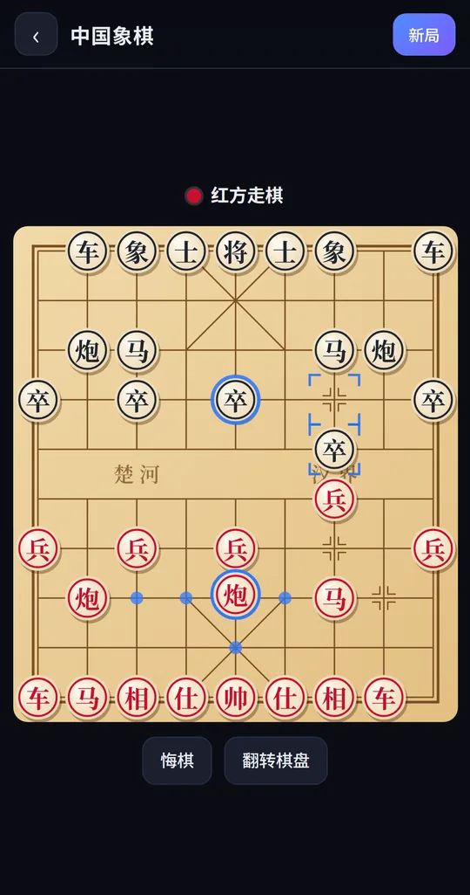
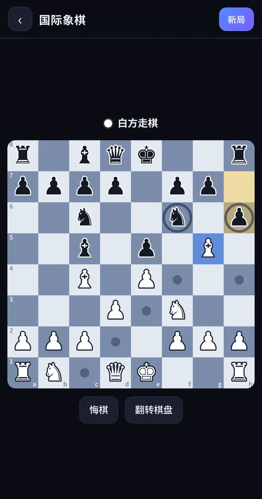
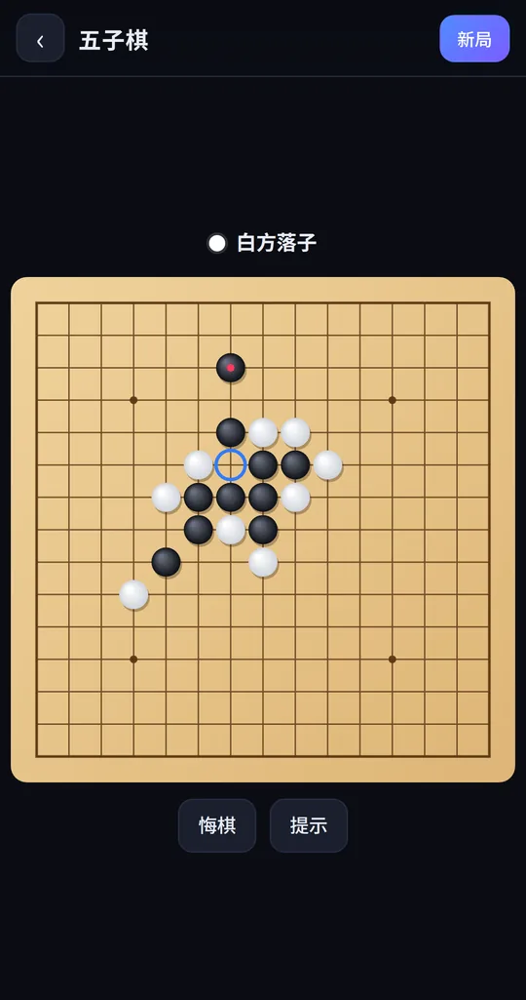
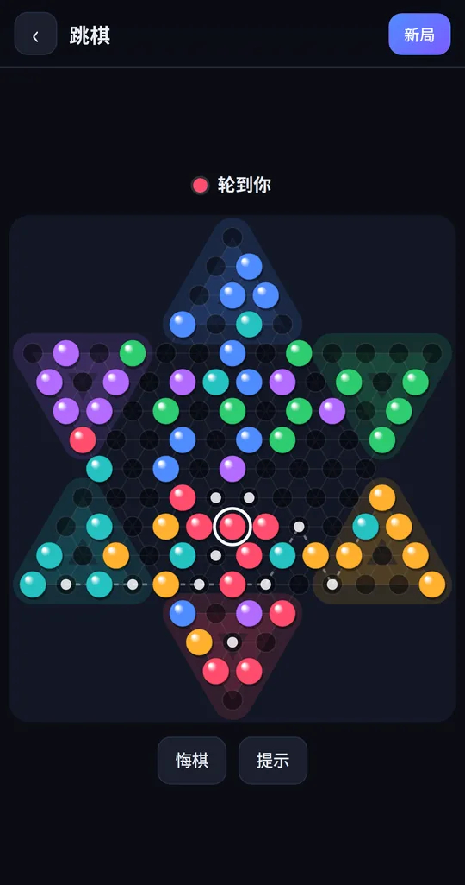
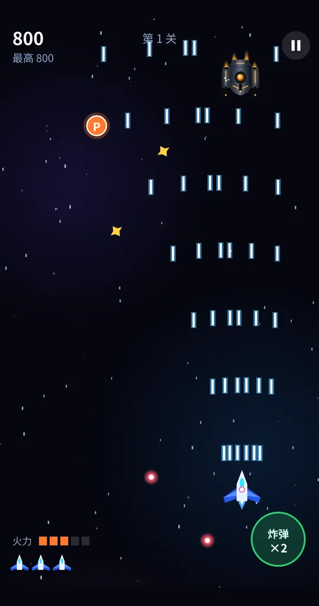
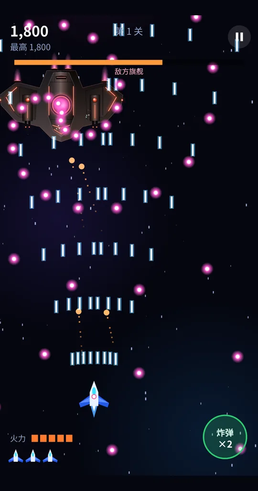

<div align="center">

<a href="https://code.jiangshu.ai/playbox/"></a>

# 童年游戏盒 PlayBox

**开源 · 免费 · 无广告 · 手机浏览器打开即玩的经典小游戏合集**

中国象棋 · 国际象棋 · 五子棋 · 飞行棋 · 跳棋 · 飞机射击，人机对战和多人同屏都能玩

[](https://code.jiangshu.ai/playbox/)

[](LICENSE)
[](#-游戏一览)
[](#-本地运行)
[](https://code.jiangshu.ai/playbox/)
[](#-参与贡献)
[](https://github.com/yzfly/playbox)

[在线试玩](https://code.jiangshu.ai/playbox/) · [游戏截图](#-游戏截图) · [游戏一览](#-游戏一览) · [本地运行](#-本地运行) · [English](#english)

</div>

---

## 📱 手机扫码就能玩

<table>
<tr>
<td width="180" align="center"></td>
<td>

用手机相机扫描左边的二维码，或直接打开 **https://code.jiangshu.ai/playbox/**

- 不用下载安装，也不用注册登录，打开就能玩
- 在浏览器菜单里选“添加到主屏幕”，用起来就像一个 App
- 没有广告，也不收集个人信息，游戏进度只存在你自己的手机上

</td>
</tr>
</table>

## 🖼 游戏截图

<table>
<tr>
<td align="center" width="33%"><br><b>游戏大厅</b><br><sub>搜索、分类、最近玩过</sub></td>
<td align="center" width="33%"><br><b>中国象棋</b><br><sub>木纹棋盘，点子显示可走位置</sub></td>
<td align="center" width="33%"><br><b>国际象棋</b><br><sub>标出上一步和可走格</sub></td>
</tr>
<tr>
<td align="center"><br><b>五子棋</b><br><sub>15 路棋盘，蓝圈是落子提示</sub></td>
<td align="center"><br><b>飞行棋</b><br><sub>1 到 4 人，可和电脑一起玩</sub></td>
<td align="center"><br><b>跳棋</b><br><sub>六人满盘，连跳路线一目了然</sub></td>
</tr>
<tr>
<td align="center"><br><b>星穹迅击</b><br><sub>原创竖版飞行射击</sub></td>
<td align="center"><br><b>星穹迅击 · 战斗</b><br><sub>拖动战机，自动射击，收集火力</sub></td>
<td align="center"><br><b>星穹迅击 · Boss</b><br><sub>旗舰弹幕战</sub></td>
</tr>
</table>

## 🎮 游戏一览

| 游戏 | 玩法 | 模式 | 试玩 |
|---|---|---|---|
| ✈ **星穹迅击** | 原创竖版飞机射击：拖动战机躲弹幕，吃道具提升火力，每关都有旗舰 Boss | 单人 | [▶ 开玩](https://code.jiangshu.ai/playbox/games/skybolt/) |
| 帥 **中国象棋** | 规则完整：蹩马腿、塞象眼、炮翻山、将帅不能照面，无子可走（困毙）判负 | 人机三档 / 双人同屏 | [▶ 开玩](https://code.jiangshu.ai/playbox/games/xiangqi/) |
| ♞ **国际象棋** | 王车易位、吃过路兵、兵升变可选，逼和、50 回合、三次重复都判和 | 人机三档 / 双人同屏 | [▶ 开玩](https://code.jiangshu.ai/playbox/games/chess/) |
| ● **五子棋** | 15 路标准棋盘，先连五子者胜，有落子提示和悔棋 | 人机三档 / 双人同屏 | [▶ 开玩](https://code.jiangshu.ai/playbox/games/gomoku/) |
| 🎲 **飞行棋** | 掷 6 起飞、6 点再掷、同色跳、飞行捷径、撞机回营，终点必须正好走到 | 1–4 人，可混电脑 | [▶ 开玩](https://code.jiangshu.ai/playbox/games/feixingqi/) |
| ✶ **跳棋** | 六角星棋盘，可以单步走也可以连跳，先把棋子全部移到对面的人获胜 | 2 / 3 / 6 人，可混电脑 | [▶ 开玩](https://code.jiangshu.ai/playbox/games/tiaoqi/) |

每个棋类游戏右上角都有「玩法」按钮，没玩过的也能马上学会。

## ✨ 为什么做这个

- **打开即玩**：纯静态 HTML5 + Canvas，没有框架，也不用构建，首页加载只要几十 KB。
- **干净**：没有广告、弹窗、内购，不追踪用户。
- **电脑有真本事**：象棋和国际象棋用 α-β 搜索加静态搜索，放在 Web Worker 里计算，界面不会卡；五子棋按棋型打分，飞行棋和跳棋的电脑会自己权衡策略。
- **规则可靠**：象棋和国际象棋用 [perft](https://www.chessprogramming.org/Perft) 走法计数和公认标准值逐层核对，飞行棋、跳棋用几百局电脑自对弈验证。
- **适配手机**：按设备像素比高清绘制，全部触摸操作，支持刘海屏安全区，可以添加到主屏幕。
- **真机测试**：每个游戏都在真实的安卓手机上完整玩过一遍。

## 🚀 本地运行

```bash
git clone https://github.com/yzfly/playbox.git
cd playbox
python3 -m http.server 8765   # 然后在浏览器打开 http://localhost:8765
npm test                      # 运行规则引擎测试，不需要安装任何依赖
```

也可以直接把整个目录上传到 GitHub Pages、Netlify、Vercel 或任意静态服务器。

## 🗂 项目结构

```
playbox/
├── index.html            # 游戏大厅
├── games.js              # 游戏清单（新游戏在这里登记）
├── shared/               # 公共样式与工具：存储、底部面板、画布适配、AI Worker、玩法说明
├── games/<id>/           # 每个游戏一个目录
│   ├── index.html        #   界面与交互
│   └── engine.js         #   规则与 AI（与界面分离，可以在 Node 里测试）
├── tests/                # 引擎测试：perft 校验、自对弈
└── assets/               # 截图与分享图
```

## 🗺 路线图

- [x] 游戏大厅 + 星穹迅击
- [x] 中国象棋、国际象棋、五子棋、飞行棋、跳棋
- [ ] 抓钩挖矿类：限时抓宝石、炸药、商店
- [ ] 双人合作闯关：两个角色各有属性，配合开机关
- [ ] 弹弓物理：发射弹丸推倒建筑
- [ ] 坦克大战类：守住基地，地形可以打掉
- [ ] 贪吃蛇、俄罗斯方块类、扫雷、2048 等休闲经典

想要什么游戏，欢迎在 [Issues](https://github.com/yzfly/playbox/issues) 里提。

## 🤝 参与贡献

新增一个游戏只要三步：

1. 新建 `games/<id>/index.html`，引入 `../../shared/ui.css` 和 `../../shared/ui.js`；
2. 在 `games.js` 里加一项 `{ id, name, desc, cat, glyph, c1, c2, tags }`；
3. 有规则逻辑的话写进单独的 `engine.js`，并在 `tests/` 里补测试。

## ⚖️ 原创约定

本项目只收录**原创实现**。象棋、围棋、五子棋这类传统棋牌规则属于公有领域；致敬经典电子游戏时只借鉴玩法类型，名字、角色、美术、关卡、音乐全部原创，不使用任何商业游戏的素材和商标。

---

## English

**PlayBox** is an open-source, ad-free collection of classic mini games for mobile browsers — no install, no sign-up, just open and play.

- **Board games**: Xiangqi (Chinese chess), Chess, Gomoku (five in a row), Aeroplane Chess (Ludo-style, 1–4 players), Chinese Checkers (2/3/6 players)
- **Arcade**: *Skybolt*, an original vertical scrolling shoot 'em up with boss fights
- Play against the computer (3 difficulty levels) or pass-and-play with friends on one phone
- Pure static HTML5 Canvas, zero dependencies, installable as a PWA
- Move generators verified with perft against published reference counts

▶ **Play now: https://code.jiangshu.ai/playbox/**

## 📄 许可

[MIT](LICENSE) © yzfly
